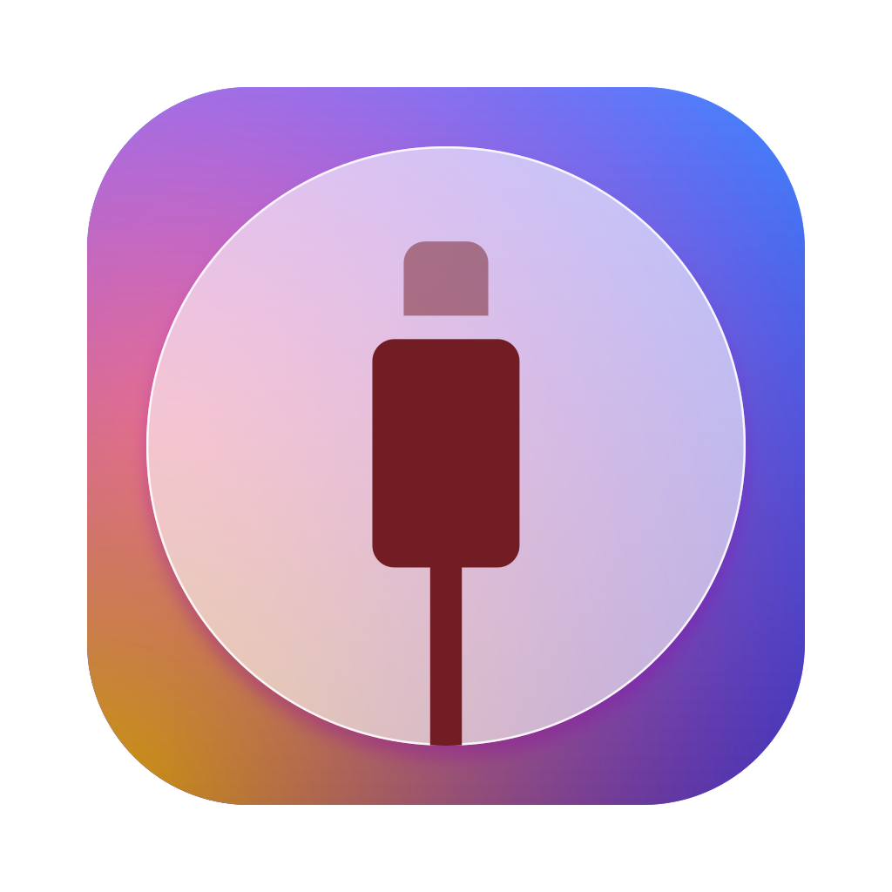

<h1 align="center">FlekPair</h1>

Pairing files for iPhone and iPad, made on your Mac or PC and sent straight to FlekDeck.

Connect your device, click **Start pairing**, and FlekPair makes the device's pairing file. With Premium Access it goes straight to the FlekDeck app on the device, where a tap on **Refresh** picks it up. You can always save the file on your computer instead.

## Download

| System | Download |
| --- | --- |
| macOS, Apple silicon and Intel | [FlekPair-darwin-universal.dmg](https://github.com/Alex23Grig/flekpair/releases/latest/download/FlekPair-darwin-universal.dmg) |
| Windows, 64-bit | [FlekPair-windows-x64.exe](https://github.com/Alex23Grig/flekpair/releases/latest/download/FlekPair-windows-x64.exe) |

These always fetch the latest version. What changed in each version is on the [releases page](https://github.com/Alex23Grig/flekpair/releases).

## How to use

1. Connect your iPhone or iPad with a USB cable and unlock it. The device must have a passcode set.
2. Open FlekPair. Your device appears with its name, iOS version and UDID, and FlekPair checks whether it has Premium Access.
3. Click **Start pairing**. If the device asks, tap **Trust** and enter your passcode.
4. With **Automatically import into FlekDeck** ticked, FlekPair sends the pairing file as soon as it's made. Open FlekDeck on the device and tap **Refresh**.

The upload goes to FlekStore's server, under the device's UDID, and it is not encrypted. Read [what that means](#what-is-in-the-file) before using it for a device you care about.

### Premium Access

Automatic import into FlekDeck needs Premium Access, which you buy in the FlekDeck app on your device. FlekPair checks it as soon as your device appears and shows the answer on the device card:

- **Active**: the pairing file can go straight to FlekDeck.
- **Not active**: FlekPair still makes the pairing file, and you can save it. After buying Premium Access in FlekDeck, click **Check again**, then **Import into FlekDeck**. There's no need to pair again.
- **Access not checked**: the server couldn't be reached. Click **Retry**, or save the file.

Making and saving a pairing file is always free.

### Keeping the file on this computer

After pairing, click **Save pairing file**. FlekPair asks where to save it, starting in your Downloads folder, as `pairingFile.plist`. On a Mac the file is readable by your user only.

To only make the file, untick **Automatically import into FlekDeck** before you click **Start pairing**.

With more than one device connected, choose one from the menu on the device's name.

The device's UDID is shown on its card as soon as it is plugged in, before it is trusted. The button next to it copies it.

### Without a cable

If you have connected the device to this computer before and both are on the same network, unlock it and it should appear in FlekPair marked **Wi-Fi**, with no cable. If it doesn't appear, connect it with a cable as usual. The waiting screen says the same.

The first connection, where you tap **Trust**, always needs a cable, and so does a device that has stopped trusting the computer. The device also has to be set to show up on Wi-Fi: **Show this iPhone when on Wi-Fi** in Finder, or **Sync with this iPhone over Wi-Fi** in iTunes or Apple Devices.

On a Mac, macOS finds the device. On Windows FlekPair searches the network itself and answers the device's heartbeat, so Apple's driver is enough and neither iTunes nor Bonjour is needed. To recognise a device there, it keeps the UDIDs of devices it has seen on a cable in its data folder.

A phone that nothing is talking to drops off the network within a minute. If yours doesn't show up, wake and unlock it, and give it a minute or two after it joins the network. Once FlekPair sees the phone it keeps a connection to it open, so it stays listed. It stops doing that ten minutes after you last used FlekPair, so that an app left open doesn't keep a phone awake.

If a device is both plugged in and on Wi-Fi, FlekPair uses the cable.

### Windows: Apple's drivers

Windows can't talk to an iPhone until Apple's device driver ("Apple Mobile Device Support") is installed. If you have iTunes, you already have it.

If it is missing, FlekPair shows **Apple drivers required** and offers **Download & install**. That downloads Apple's iTunes installer from apple.com (about 200 MB), takes only the driver package out of it, checks that Windows sees Apple's signature on it, and installs just that. Windows asks for permission once. Apple's license doesn't allow shipping the driver inside FlekPair, which is why it is fetched from Apple instead. If the installation fails, **Try again** installs again without downloading a second time.

If you would rather install it yourself, the same screen links to Apple's [iTunes download](https://www.apple.com/itunes/download/win64) and to [Apple Devices](https://apps.microsoft.com/detail/9np83lwlpz9k) in the Microsoft Store. Either brings the driver with it, and FlekPair notices on its own once it is there.

If the driver is installed but its service isn't running, FlekPair offers to start it. If iTunes or Apple Devices from the Microsoft Store is installed, FlekPair asks you to open it instead of installing anything: the Store versions bring their own copy of the driver, which works while that app is running.

### Good to know

- Released Mac builds are signed and notarized by Apple, so macOS only asks once whether to open an app downloaded from the internet. The Windows installer is not signed, so Windows warns before the first launch; choose **More info → Run anyway**.
- The interface is in English.

## What is in the file

A combined pairing file, for FlekDeck and other apps that ask for one, such as SideStore, StikDebug and LiveContainer:

- this computer's lockdown pairing record for the device, and
- on iOS 17.4 and later, a remote pairing (RPPairing) record created for this file.

Making the file also turns on Wi-Fi debugging on the device (`EnableWifiDebugging`), which those apps rely on.

**Treat the file like a password.** Whoever holds it can connect to your device from the same network, with the standing of a computer you trusted.

Automatic import uploads the file as it is to FlekStore's server. The server gives it to anyone who asks for the device's UDID, and a UDID is not a secret. To check Premium Access, FlekPair sends the device's UDID to the same server. Saving the file keeps it on this computer and uploads nothing.

## Troubleshooting

**Need a hand?** at the bottom of the window has the usual fixes. When something goes wrong, **Error details** shows the technical message, and **Copy** copies it.

For more detail, start FlekPair from a terminal with `FLEKPAIR_LOG=debug` to print the device conversation to stderr. That output includes key material, so don't post it publicly.

## Source code

This repository holds FlekPair's releases. Its source code is not published.

## Credits

- [idevice](https://github.com/jkcoxson/idevice) by [jkcoxson](https://github.com/jkcoxson) for communicating with iOS devices
- [idevice_pair](https://github.com/jkcoxson/idevice_pair) was used as a reference for pairing file management
- [Lucide](https://lucide.dev) for the interface icons
- App made with [tauri](https://tauri.app)

## Open-source components

FlekPair is built with open-source components. Their license notices come with the app: in `FlekPair.app` → Contents → Resources → `THIRD_PARTY_NOTICES.txt` on a Mac, and in FlekPair's installation folder on Windows.
